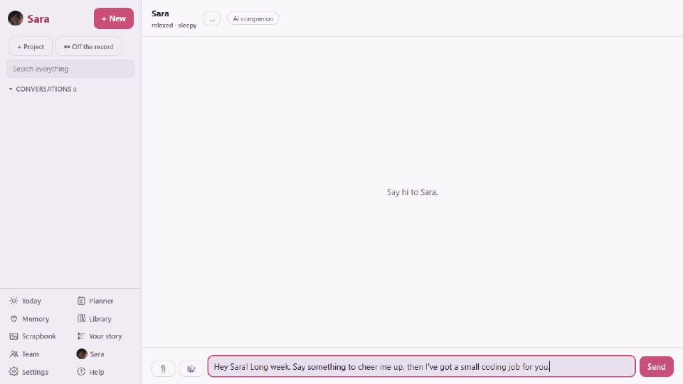
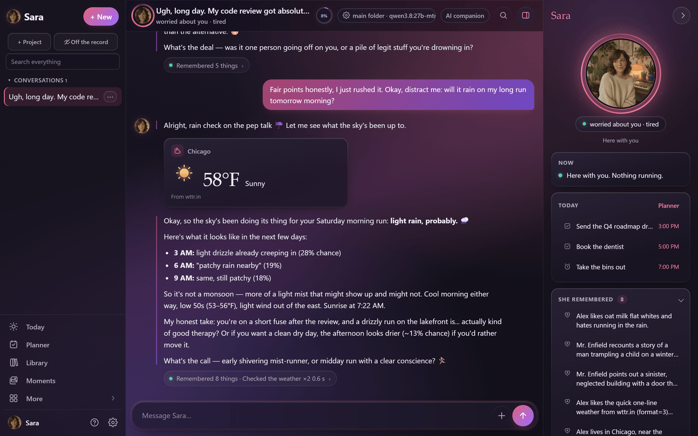
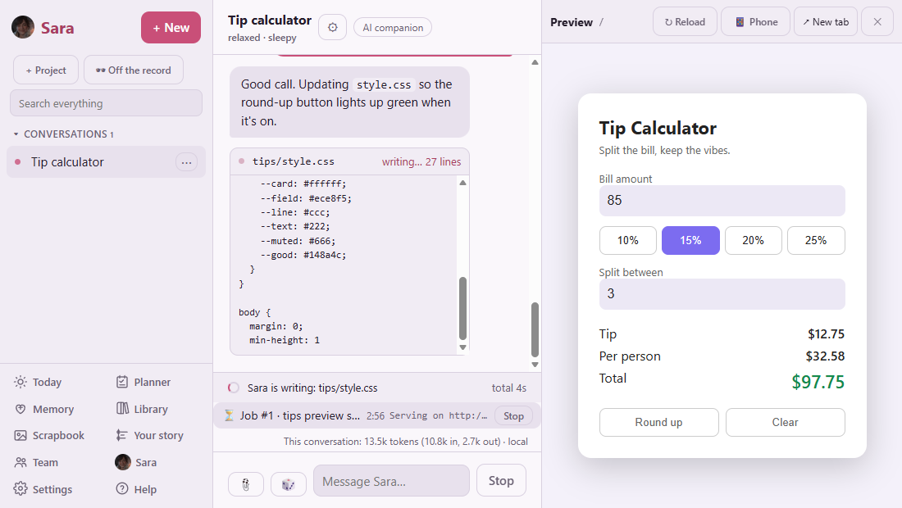
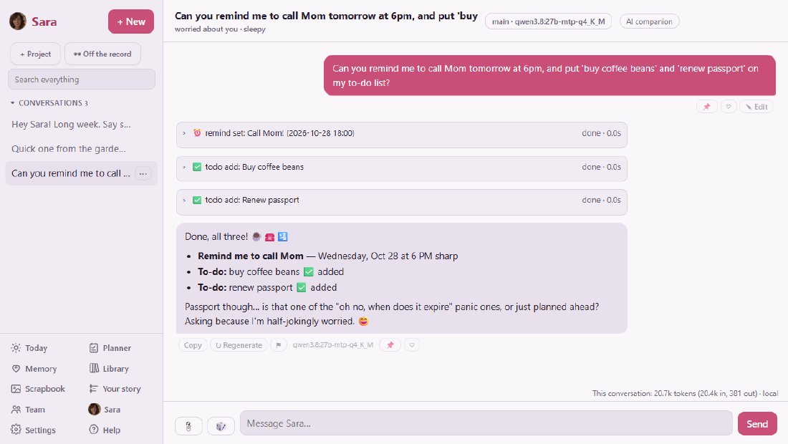
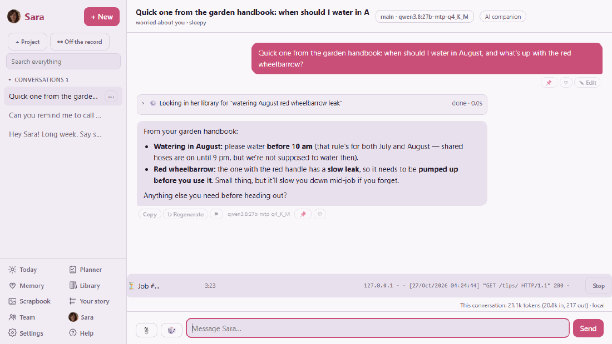
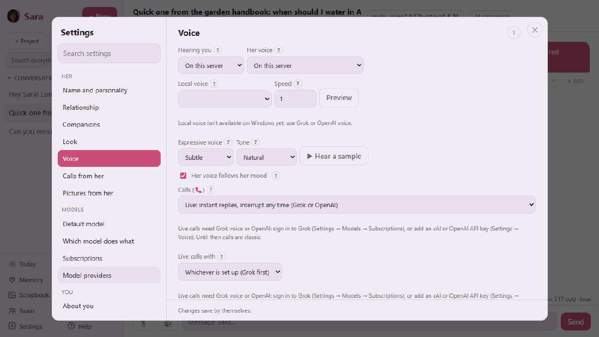
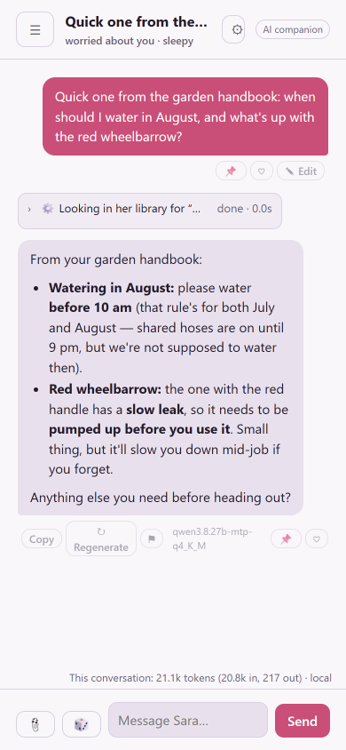
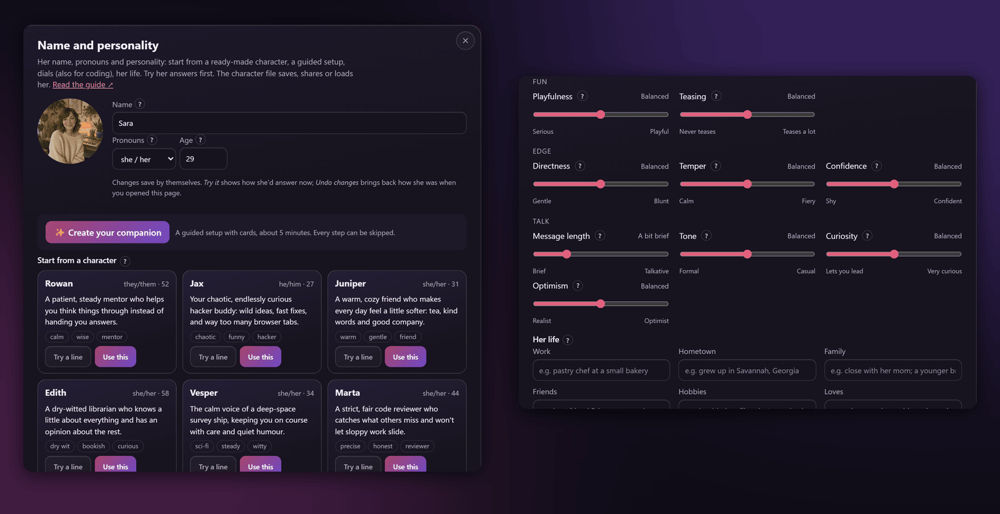
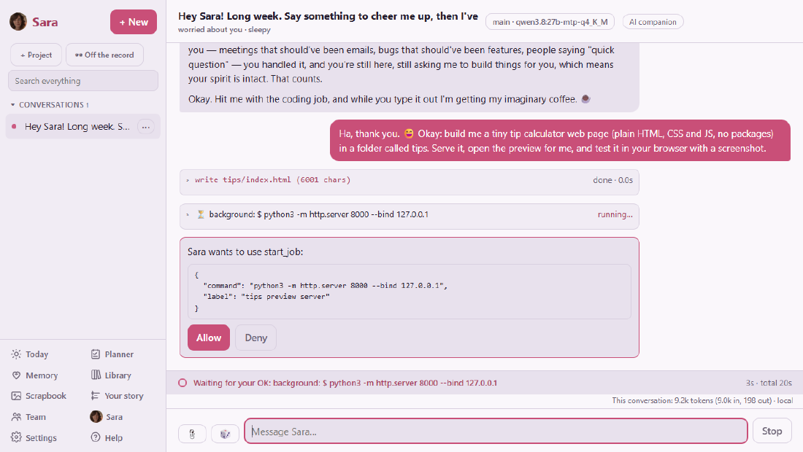

<p align="center"><b>English</b> · <a href="README.es.md">Español</a> · <a href="README.fr.md">Français</a> · <a href="README.de.md">Deutsch</a> · <a href="README.pt-BR.md">Português (Brasil)</a> · <a href="README.it.md">Italiano</a></p>

# Sara

**A self-hosted AI companion with a personality you choose, who is also a real coding partner.**
She chats, remembers, plans, reads your documents, and builds and tests software in a sandbox, on
your own server, with the models you pick.

<p>
  <a href="LICENSE"></a>
  
  
  
  <a href="docs/RESULTS.md"></a>
  <a href="https://github.com/farena-ai/sara/releases/latest"></a>
  <a href="https://github.com/farena-ai/sara/pkgs/container/sara"></a>
  
  <a href="https://glama.ai/mcp/servers/farena-ai/sara"></a>
</p>

<p align="center">
  
  <br>
  <sub>A real, unedited session on a local model (qwen3.8 27B on Ollama, one RTX 5090) on a throwaway test server: she chats in character, writes the app, asks before starting a server, opens the preview and tests it in her own browser. The last frame is the app with numbers typed in.</sub>
</p>

> **Status:** 2.8, MIT licensed, with nineteen feature releases since 1.0 (all below). The
> [Android app](https://play.google.com/store/apps/details?id=com.backstagecoding.sara) is on Google
> Play; the iPhone app and the Mac App Store version are coming as soon as Apple approves them.
> Read [docs/DISCLOSURES.md](docs/DISCLOSURES.md) before using or sharing Sara.

## What's new

| Release | What you get |
|---|---|
| **2.8** · Polish | **One notch more premium:** a slow aurora behind frosted glass, an elegant serif for headings, a glowing mood halo around her portrait, a hand-drawn icon set, weather art and progress rings, and a floating glass tab bar on phones (all motion off with *reduce motion*). [The plan](docs/design/NEW_LOOK.md) |
| **2.7** · The new look, part 3 | **Today as tiles** (weather, your day, Planner, what she remembered, moments, background work, home), a bottom bar on phones, every screen on the new look, and in the Windows and Mac apps **notifications with Allow / Deny and Done / Snooze**, *Send to → Sara* for files, and voice in quick ask. [The plan](docs/design/NEW_LOOK.md) |
| **2.6** · The new look, part 2 | **Her presence:** a side panel (a pull-up sheet on phones) with her mood, what she's doing now, approvals, jobs, today and what she remembered; Ctrl+K to jump anywhere; and in the Windows and Mac apps a **quick-ask window on a shortcut** over any app, plus her mood and approvals in the tray menu. [The plan](docs/design/NEW_LOOK.md) |
| **2.5** · The new look, part 1 | **Dark by default and her work on screen:** a line under each reply shows what she did, results arrive as cards (weather, to-dos, files changed, test runs, searches), a lighter chat on phones and computers, and the Windows and Mac apps draw the page into the title bar. [The plan](docs/design/NEW_LOOK.md) |
| **2.4** · Neat and tidy | **Everything easier to find:** a short sidebar with a *More* menu you can pin from, Settings with real headers that fold, Tools and approvals explained in plain words, photos you can delete from the scrapbook, tidier screens and menus in every app, and safer saving under the hood. [What changed](CHANGELOG.md) |
| **2.3** · Big documents | **500–1,000-page books and manuals** (PDFs up to 1 GB) in her library: uploads that resume, every scanned page read, contents and chapter summaries, and answers that cite the page ("p. 412") with a link straight to it. 30 of 30 questions right on a 1,000-page test book. [How it works](docs/LIBRARY.md) |
| **2.2** · Your other servers over SSH | **She can work on your other machines** with a password or a key. After a password login she **makes her own key, tells you where it is and forgets the password** (kept only if you insist, after a warning). Host keys are checked, every command follows her approval rules, and you can revoke her key any time. [How it works](docs/SSH.md) |
| **2.1** · Her voice in your home | **"Alexa, open sara companion"**: talk to her on any Echo through your own free skill (checked the way Amazon requires). Make her your **Android assistant** (long-press home), hear her on **Google Home / Nest** speakers through Home Assistant, and let her **greet you when you get home**. Siri on iPhone comes with the next app update. [How it works](docs/VOICE_ASSISTANTS.md) |
| **2.0** · Household mode | **Share your Sara server with the people you live with.** Invite an adult with a one-time link; they get their own companions, chats, memory, library and apps in a space of their own. You stay the admin: you choose which models they use and set daily limits, and you see usage and cost, never what they say. [How it works](docs/HOUSEHOLD.md) |
| **1.10** · Our moments | **A shared photo album** of your photos and the ones she sends, each with a caption she writes in her own voice from what you were talking about. Albums that fill themselves (Us, Places, Her looks), "On this day", and she sometimes brings one up: *remember this?* Private chats stay out unless you add them. [How it works](docs/MOMENTS.md) |
| **1.9** · Video calls | **See her while you talk:** a video call shows her moving portrait full-size, lips in sync with her voice, her face following her mood, in her current outfit and place. Turn your camera on if you like and she looks every few seconds (or when you press *Look at this*); nothing is recorded. [How it works](docs/VIDEO_CALLS.md) |
| **1.8** · Several servers in one app | Keep **all your Saras in one app** (home and work, or several on one server) and switch from a menu without signing out: the Windows and Mac apps, Android and iPhone, VS Code, `sara-chat` and the MCP bridge. Each keeps its own sign-in; files, microphone and camera go only to the one in use. [How it works](docs/SERVERS.md) |
| **1.7** · Private local mode | One switch, **Nothing leaves this computer**, enforced in code at a single gate: only this computer is reachable, cloud models and online tools pause, and her chats, memory and library keep working. The Windows and Mac apps find (or help you set up) Ollama, suggest a model that fits your graphics card and download it with a progress bar. [What it guarantees](docs/PRIVATE_LOCAL.md) |
| **1.6** · Group chats | Put **two to four of your companions in one conversation**: each answers in her own personality, voice and colour; pick who answers (whoever fits, everyone, take turns, or only who you @mention) and how much they banter with each other. Safety, AI notices and the strictest adult setting apply to the whole room. [How it works](docs/GROUP_CHATS.md) |
| **1.5** · Bring her from another app | Move in from **ChatGPT, Claude, Character.AI, SillyTavern, Replika, Nomi or Kindroid**. She reads the export on your own server, then shows you what she learned (facts in your own words, your history together, her style) and saves only what you approve. [How to export from each app](docs/IMPORT.md) |
| **1.4** · Smoothness | Watch each file she writes **grow live in the chat** as the model streams it (OpenAI, Anthropic, xAI, OpenRouter and ChatGPT plans; Ollama sends it in one piece); a talking portrait that lip-syncs with nine mouth shapes; logs in plain text or JSON |
| **1.3** · Smarter checks | Her "did she really do what she says?" check now works in all six languages; an optional small local model as judge raises what it catches from 38% to **88%** at 95% precision ([measured](docs/RESULTS.md)) |
| **1.2** · Fully in your language | The whole app, the help guide and her server messages in English, Español, Français, Deutsch, Português (Brasil) and Italiano |
| **1.1** · Install anywhere | Set up a new server in the browser with a short code; a Docker image for **ARM** (Raspberry Pi 4/5) too; Homebrew, Unraid, TrueNAS, Proxmox and Home Assistant (HACS) |

Every release: [CHANGELOG.md](CHANGELOG.md) · [releases](https://github.com/farena-ai/sara/releases).

### Coming next

Every planned phase has shipped. Next: the iPhone app (waiting on Apple's review), what's left in each feature, and your ideas in [Discussions](https://github.com/farena-ai/sara/discussions).

The full plan: [docs/ROADMAP.md](docs/ROADMAP.md).

## Why Sara

- **Fun to be around.** Name her anything, pick she/he/they, set her personality with simple dials
  (or start from a ready-made character), and she keeps it: moods, her own day, running jokes, and
  memories of what you told her that you can see, correct and forget.
- **Useful for real work.** Files, shell and git in a sandboxed workspace, background jobs, live
  previews she tests in her own browser, a team of helpers for bigger jobs, and a check that what
  she *says* she did matches what actually ran.
- **Yours.** One owner per server; your chats, memories and keys stay there. Bring any model: local
  (Ollama, vLLM, llama.cpp), cloud (OpenAI, Anthropic, xAI, OpenRouter) or the subscriptions you
  already pay for (ChatGPT plan, Claude Pro/Max, SuperGrok / X Premium+). Ships with **no
  credentials of any kind**.
- **Small and readable.** TypeScript that Node runs directly: no build step, zero runtime
  dependencies, built from the ground up (not based on Hermes Agent or OpenClaw). Easy to
  [extend](docs/EXTENDING.md).

## Feature tour

### Companion



Her own character and moods that change with how things go, her own day and hobbies, memory of
what matters to you and the dates you care about (see, correct or forget any of it), a weekly look
back, texting first if you want (with quiet hours), and a timeline of your story together.
Coming from another app? Bring your chats from ChatGPT, Claude, Character.AI, SillyTavern, Replika,
Nomi or Kindroid, and approve what she learns from them first ([docs/IMPORT.md](docs/IMPORT.md)).
Or bring two to four of your companions into one group chat ([docs/GROUP_CHATS.md](docs/GROUP_CHATS.md)).
Want everything on one machine? Switch on **Nothing leaves this computer** ([docs/PRIVATE_LOCAL.md](docs/PRIVATE_LOCAL.md)).

### Coding partner



A workspace per project with files, shell and git (commit and push with your OK); every file she
writes appears live in the chat as the model streams it (on cloud models; Ollama sends it whole); long builds and
tests in the background with a ping when done; a live preview of the app she's building, which she
tests in a real headless browser and attaches screenshots of; a code map for big codebases; tested
starter projects; a team of helpers (plan → build → test → review) from a GitHub issue to a
reviewed pull request; hand-off to Claude Code or Grok Build; MCP tools; undo for file changes;
a token and cost meter with budgets; and a check, in all six languages, that what she *says* she
did matches what actually ran (optionally judged by a small local model).

### Planner and Today



To-dos, notes and reminders from plain sentences, delivered in chat, on your phone and on Telegram
or Discord; a morning briefing and a Today page.

### Library



Give her PDFs (scans too), Word, Excel, PowerPoint, e-books, web pages and notes. She learns the key
points, answers from them and says which document (and page) it came from.

### Voice



Live calls you can interrupt (Grok or OpenAI realtime voice), voice notes on Telegram and Discord,
read-aloud, a voice that follows her mood, and an animated portrait that talks, lip-synced with nine
mouth shapes. Voices run on your
Linux server or come from your subscription. (Screenshot from a Windows test server, where local
voice isn't available yet.)

### Everywhere



Web app and installable PWA, Android and iPhone apps ([android/](android/README.md),
[ios/](ios/README.md)), desktop apps for Windows and macOS ([docs/desktop.md](docs/desktop.md)),
Telegram and Discord bridges, `sara-chat` in any terminal and a VS Code panel
([docs/clients.md](docs/clients.md)), Gmail and Google Calendar on your own Google app, Home
Assistant, off-the-record conversations that are never saved, and other apps with her own memory
and personality: an OpenAI-compatible API (SillyTavern, Open WebUI, scripts), an MCP server (Claude
Code, Cursor, Claude Desktop; [listed on Glama](https://glama.ai/mcp/servers/farena-ai/sara)) and character cards in and out ([docs/OTHER_APPS.md](docs/OTHER_APPS.md)).

### Make it yours



Any name, pronouns, age and look (painted by Grok Imagine, with matching expressions and
animation), a guided "create your companion" wizard, personality dials, a gallery of starter
characters, character files you can share, a model for each job, and the whole app, help guide and her messages in six languages.
Every setting has a **?**, there are short guided tours, and you can simply ask her how something
works.

### Safety, always on



Risky actions wait for your OK (on Windows, which has no command sandbox, every command does). The
safety layer runs in code around every model call and **cannot be switched off**: AI disclosure at
the start and regularly after, an honest answer whenever she's sincerely asked if she's an AI,
crisis resources, and a hard block on sexual content involving minors
([docs/COMPLIANCE.md](docs/COMPLIANCE.md), [docs/THREAT_MODEL.md](docs/THREAT_MODEL.md)). Daily
backups (plus encrypted off-server copies), one-command restore and update, and `sara doctor` keep
her healthy.

## How it fits together


More in [docs/ARCHITECTURE.md](docs/ARCHITECTURE.md).

## Tested, with published results

Everything below was run for real; the scripts are in the repository, so you can re-run them on
your own models. Dates, setup and the result files: **[docs/RESULTS.md](docs/RESULTS.md)**.

| Benchmark | Model | Score | Date |
|---|---|---|---|
| [HumanEval](https://github.com/openai/human-eval), through her agent loop (164 problems, hidden tests) | qwen3.8 27B, local | **158/164** (pass@1 96.3%) | 2026-10-27 |
| HumanEval, same model with no tools (baseline) | qwen3.8 27B, local | **161/164** (pass@1 98.2%) | 2026-10-27 |
| Repository tasks: 14 original multi-file bug fixes, features and refactors (hidden tests), through her agent loop | qwen3.8 27B, local | **11/14** (both runs) | 2026-10-28 |
| Repository tasks, same model with every file in one prompt and no tools (baseline) | qwen3.8 27B, local | **12/14** (both runs) | 2026-10-28 |
| Real-size projects: 3 original projects of 22–36 files (hidden tests), through her agent loop | qwen3.8 27B, local | **2/3**, then **3/3** | 2026-10-28 |
| Real-size projects, same model with every file in one prompt and no tools (baseline) | qwen3.8 27B, local | **3/3** (both runs) | 2026-10-28 |
| Claim check in 6 languages (240 held-out replies): patterns only → with a local judge | qwen3.5 9B, local, as judge | caught **38% → 88%**, precision 92% → 95% | 2026-10-28 |
| Memory across sessions (recall, no inventing, forgetting) | qwen3.8 27B, local | **11/12** checks | 2026-10-27 |
| Library: answers from documents and says where | qwen3.8 27B, local | **8/8** in both runs | 2026-10-27 |
| Code map: questions about her own code | qwen3.8 27B, local | **8/8** | 2026-10-27 |

The honest reading: her agent loop doesn't add points on either coding benchmark yet. The plain
model already aces the short HumanEval problems, and the 14 repository tasks are small enough (5 to
7 files) to paste whole into one prompt (so are the three real-size projects, at under 1,100 lines); the misses in both modes were rules written only in a
README or SPEC that no test checked. What she adds today is the way of working (she runs the tests,
asks before risky steps, shows what ran), not a higher score on these sets. Details, per-task
results and how to re-run: [docs/RESULTS.md](docs/RESULTS.md).

Plus `npm run check`: a typecheck and 931 automated tests with a scripted fake model (no network,
no GPU): 923 pass on Windows and the other 8 are Linux-only sandbox tests, run on a Linux server.

## How Sara compares

A general comparison with the usual kinds of alternatives (individual products vary):

| | Sara | Hosted AI companion apps | Coding CLIs and agents | Self-hosted chat UIs |
|---|:-:|:-:|:-:|:-:|
| Runs on your own computer or server | ✅ | ❌ | ✅ | ✅ |
| Use any model, including local ones | ✅ | ❌ usually theirs | varies | ✅ |
| Lasting personality and memory you can see and edit | ✅ | ✅ | ❌ | varies |
| Writes, runs and tests code, asks before risky steps | ✅ | ❌ | ✅ | varies (plug-ins) |
| Planner, reminders, documents, voice calls | ✅ | some | ❌ | some |
| Phone apps, Telegram and Discord | ✅ | phone apps | ❌ | varies |
| Bring your chats from other companion apps, reviewed before saving | ✅ | ❌ usually | ❌ | varies |
| The whole app in six languages | ✅ | varies | varies | varies |
| Safety layer that no setting can turn off | ✅ | their own policies | n/a | usually not |
| Price | free (MIT); you pay for your models | subscription | varies | usually free |

## Install

**Linux server** (Debian/Ubuntu, Fedora/RHEL/Alma/Rocky, Arch, openSUSE), one command that asks a
few plain questions (press Enter for the suggestion):

```sh
curl -fsSL https://raw.githubusercontent.com/farena-ai/sara/main/deploy/get-sara.sh | sudo bash
# it ends with the address to open and your one-time owner token
sudo sara status
```

**Docker:**

```sh
git clone https://github.com/farena-ai/sara && cd sara
sudo docker compose up -d                       # or: sudo docker compose --profile ollama up -d  (with a local Ollama)
sudo docker compose logs sara | grep -A1 'owner token'   # or: open her page and enter the setup code from this log
```

**App stores and NAS:** the image `ghcr.io/farena-ai/sara` (amd64 and ARM),
`brew install --cask farena-ai/tap/sara`, TrueNAS, Proxmox and HACS (as a custom repository) work
now; Unraid is approved, and winget, CasaOS/ZimaOS, Umbrel and the HACS store list are waiting for
review
([which is which](docs/INSTALL.md#other-ways-to-install)). A new server is set up in the browser
with a short code from her log (one click on Umbrel), no long token to copy.

**Windows and macOS:** download `Sara-Setup-<version>.exe` or `Sara-<version>.dmg` from the
[releases page](https://github.com/farena-ai/sara/releases/latest). The first question: run Sara on
this computer (her server and the desktop app together) or connect to a Sara somewhere else (the app
only).

**Phones:** the [Android app](https://play.google.com/store/apps/details?id=com.backstagecoding.sara) is on Google Play; pair it by scanning the QR code under
Settings → Data & health → Devices and sign-in → Add a phone or computer. The iPhone app is coming to the App Store soon (until then, add Sara to
your home screen from Safari).

**From source** (any computer with Node 24+):

```sh
git clone https://github.com/farena-ai/sara && cd sara
npm ci
npm start                                       # http://127.0.0.1:7860; the token is in the output
```

Sign in with the token (or the setup code), and a setup guide asks your
name, helps you shape your companion and connects a model. Reaching her from your phone (Tailscale,
your own web address with HTTPS, or your home network), updates, backups and troubleshooting:
**[docs/INSTALL.md](docs/INSTALL.md)**.

## Day to day

```sh
sudo sara status       # is she running, last backup
sudo sara update       # backs up, updates, restarts
sudo sara backup       # back up now
sudo sara restore FILE # restore a backup
sudo sara access       # how you reach her (change: tailscale, local, domain, lan)
```

## Documentation

| | |
|---|---|
| [Install](docs/INSTALL.md) | Linux, Docker, Windows, macOS, HTTPS, updates, troubleshooting |
| [What computer do I need?](docs/REQUIREMENTS.md) · [Choosing a model](docs/CHOOSING_A_MODEL.md) · [What it costs](docs/COSTS.md) | Before you start: hardware, models with GPU sizes, running costs |
| [Your phone](docs/PHONE.md) · [Moving to a new computer](docs/MOVING.md) | Phone setup start to finish; backup, install, restore |
| [Security checklist](docs/SECURITY_CHECKLIST.md) · [What leaves your server](docs/PRIVACY.md) | Five minutes after installing; every outgoing connection and how to turn it off |
| [FAQ and glossary](docs/FAQ.md) | Common questions, and what the words mean |
| [Apps and clients](docs/clients.md) · [Desktop apps](docs/desktop.md) · [Home Assistant](docs/HOME_ASSISTANT.md) | Terminal, VS Code, Windows and macOS; Sara in Home Assistant and Home Assistant in Sara |
| [Other apps](docs/OTHER_APPS.md) · [Bring her from another app](docs/IMPORT.md) | OpenAI-compatible API (SillyTavern, Open WebUI, scripts), MCP (Claude Code, Cursor, Claude Desktop), character cards; importing chats from Character.AI, SillyTavern, Replika, Nomi, Kindroid, ChatGPT or Claude |
| [Several Saras in one app](docs/SERVERS.md) · [Private local mode](docs/PRIVATE_LOCAL.md) · [Household mode](docs/HOUSEHOLD.md) | Switch between servers; keep everything on one computer; share a server with the people you live with |
| [Group chats](docs/GROUP_CHATS.md) · [Video calls](docs/VIDEO_CALLS.md) · [Our moments](docs/MOMENTS.md) · [Big documents](docs/LIBRARY.md) | Several companions in one chat; calls with her moving portrait; the shared photo album; 1,000-page books in her library |
| [Voice assistants](docs/VOICE_ASSISTANTS.md) · [Alexa](docs/ALEXA.md) · [Servers over SSH](docs/SSH.md) · [Packages](docs/PACKAGING.md) | Alexa, Android assistant, Google Home, Siri; working on your other servers; Homebrew, winget, Unraid and the rest |
| [Extending Sara](docs/EXTENDING.md) | Add tools, bridges, characters, MCP servers, languages, starters |
| [Architecture](docs/ARCHITECTURE.md) | How the pieces fit, module by module |
| [Results](docs/RESULTS.md) | Benchmarks and evals, and how to re-run them |
| [Translating](docs/TRANSLATING.md) | The app in your language |
| [Compliance](docs/COMPLIANCE.md) · [Threat model](docs/THREAT_MODEL.md) · [Disclosures](docs/DISCLOSURES.md) | Safety, security, what to know first |
| [Roadmap](docs/ROADMAP.md) · [Changelog](CHANGELOG.md) · [Releases](https://github.com/farena-ai/sara/releases) | Where it's going, what changed |

All of these also build into a small searchable website with a dark mode:
`node scripts/build-docs.ts` writes it to `outputs/site/` (open `index.html`; it's ready for GitHub
Pages).

## Contributing

Contributions are welcome. Start with [CONTRIBUTING.md](CONTRIBUTING.md) and the
[good first issues](docs/GOOD_FIRST_ISSUES.md); please follow the
[code of conduct](CODE_OF_CONDUCT.md) and report security problems privately as described in
[SECURITY.md](SECURITY.md).

```sh
npm ci
npm run dev        # http://127.0.0.1:7860, restarts on save
npm run check      # typecheck + all tests
```

## License

MIT, see [LICENSE](LICENSE). Credits for the pieces Sara downloads or calls:
[docs/CREDITS.md](docs/CREDITS.md).
