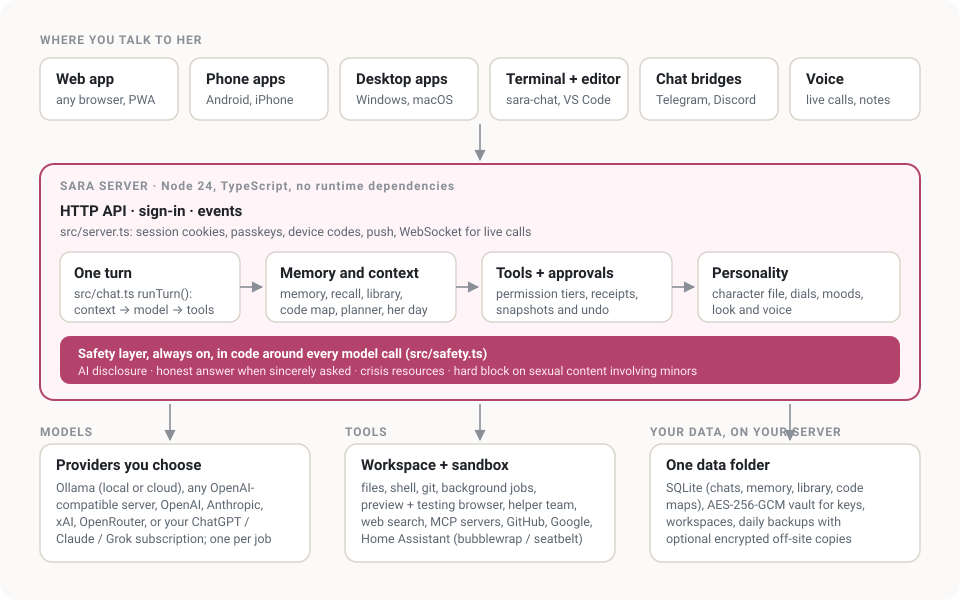

# Architecture



To add tools, bridges, characters, MCP servers, languages or starter templates, see
[EXTENDING.md](EXTENDING.md) and the working examples in [`examples/`](../examples/).

The original sketch from the first phase:

```
┌──────────────── Interfaces ────────────────┐
│ Web UI (now) · CLI · Discord · Telegram ·    │
│ voice calls (WebRTC) · mobile (later)        │
└──────────────────────┬──────────────────────┘
               ┌───────▼────────┐
               │   Core daemon   │  HTTP API, auth, turn engine,
               │  (src/server)   │  scheduler + event bus (Phase 2+)
               └─┬─────┬─────┬──┬┘
                 │     │     │  │
          Providers  Tools  Memory  Persona + safety
```

## Principles

1. **One owner per server.** Sara belongs to one person. She can also take part in other spaces
   (Discord servers, Telegram groups) as a clearly labelled bot account, acting for her owner.
2. **Bring your own models.** Nothing is bundled; every credential is added by the owner and stored
   encrypted. Local models (Ollama, vLLM, llama.cpp) are first-class.
3. **No build step, zero runtime dependencies.** Node 24 runs TypeScript directly; the runtime uses only
   Node built-ins (`node:http`, `node:sqlite`, `node:crypto`). That keeps installs simple and the
   supply-chain surface small.
4. **Safety layer outside the model.** Disclosure, crisis handling and the minor-content block run
   in code before and after the model call, so they hold no matter which model is used.

## Modules

Every module in `src/`, roughly in the order they were added (the phase is noted where it helps).

| Path | Role |
|---|---|
| `src/main.ts` | Entry point; env config; first-run owner token |
| `src/server.ts` | HTTP API + static web UI, security headers, origin guard |
| `src/auth.ts` | Owner token (hash only stored), HMAC-signed session cookies, login rate limit; `setupPending` until the first owner sign-in (Phase 59) |
| `src/claim.ts` | Phase 59: first sign-in in the browser on a new server (`/api/claim`): setup code from the log or, behind a login proxy (`SARA_SETUP=browser`, Umbrel), one click; time window, private addresses only, one-time; see THREAT_MODEL.md |
| `src/chat.ts` | One turn: disclosure → safety checks → provider routing → agent loop (stream → tool calls → approvals → results → repeat) → persist |
| `src/providers/*` | Adapter interface; OpenAI-compatible and Anthropic adapters; presets. Phase 63: adapters also pass on each raw piece of a tool call's arguments (`tool_delta`: OpenAI `tool_calls[].function.arguments`, Anthropic `input_json_delta`, ChatGPT `function_call_arguments.delta`); the CLI agents keep sending whole calls |
| `src/tool-stream.ts` | Phase 63: reads half-written tool-call JSON (`partialArgs`) and turns the pieces into throttled (≤10/s), size-capped, redacted `tool_building` events (path, the newest lines of a file being written, a line count). Shown only: nothing runs until the provider sends the finished call, which goes through approvals and safety as before |
| `src/model-catalog.ts` | Phase 56: always-current model lists per provider (`<data>/model-lists.json`): first seen / New, retired only after two good checks, daily background check + Refresh, the whole Ollama Cloud catalog through an Ollama daemon with pull-before-first-use, retired models in use switched to a replacement with a notice |
| `src/vault.ts` | AES-256-GCM secret store with per-install master key |
| `src/settings.ts` | Non-secret owner settings (JSON) |
| `src/store.ts` | SQLite: conversations, messages, safety event counts |
| `src/persona.ts` + `persona/sara.json` | Character sheet → system prompt with live context |
| `src/preview.ts`, `src/ports.ts` | Phase 49: capability-URL preview proxy (`/preview/<token>/…`) to ports her own jobs listen on |
| `src/browser.ts`, `src/cdp.ts`, `src/browser-guard.ts`, `src/tools/browser.ts` | Phase 49: headless testing browser over the DevTools protocol (Sara's own WebSocket client), its network guard, and the `preview_*` / `browser_*` tools |
| `src/codemap/extract.ts` | Phase 50: line-based symbol/import extractors (TS/JS, Python, Go, Rust, Java/Kotlin/C#, C/C++, Markdown headings) with string/comment blanking and brace matching; search chunks by symbol boundaries or ~60-line windows |
| `src/codemap/store.ts`, `src/codemap/ignore.ts` | Phase 50: one SQLite map per workspace in `<data>/cache/codemap` (files, symbols, imports, chunks in FTS5 + optional vectors); incremental scan (size/mtime, then hash) in time-budgeted steps; simple `.gitignore`; symbol/word/meaning search, refs, deps |
| `src/codemap/index.ts` | Phase 50: `CodeMaps` (shared by every companion): opens maps on demand, refreshes after her file tools write and after jobs end, light re-check while in use, vectors in the background |
| `src/codemap/tools.ts` | Phase 50: `code_map`, `code_find`, `code_refs`, `code_deps` (read-only, compact file:line output) |
| `src/recipes.ts` | Phase 50: recipes (how she did tricky jobs), FTS5 + meaning search, `recipe_save` (asks first) / `recipe_find` / `recipe_use`, the coding-turn "recipes that fit" lines |
| `web/codemap.js`, `web/recipes.js` | Phase 50: the Map tab on the project page; Settings → Abilities → Recipes |
| `src/history-import/chatgpt.ts`, `src/history-import/claude.ts`, `src/history-import/types.ts` | Phase 51: readers for ChatGPT exports (conversations.json or split conversations-NNN.json; the shown branch of the `mapping` tree, system/tool/hidden/reasoning nodes left out, pictures and files noted) and Claude exports (`chat_messages` with text/thinking/tool blocks, attachments) |
| `src/history-import/index.ts` | Phase 51: `HistoryImporter`: streamed upload to a temp file (500 MB), preview, import as archived `import-chatgpt` / `import-claude` conversations (original times, `meta.importedFrom`, dedupe by source id), background learning through the memory pipeline a few a minute (pause/resume/stop, auto-pause on model failures, resumes after a restart), remove-all |
| `src/companion-import/readers.ts`, `src/companion-import/index.ts`, `src/companion-import/types.ts` | Phase 65: pure readers for companion-app chats: Character.AI (`turns`/`candidates`, older `histories`/`msgs`), SillyTavern `.jsonl`, generic JSON message lists, CSV (own RFC 4180 reader), plain text / Markdown transcripts (speaker-label detection, date lines, WhatsApp-style times); ChatGPT/Claude through the Phase 51 readers; zips through `src/library/zip.ts` with entry/total/unpack-ratio caps (`maxRatio`); 200 MB zip / 50 MB file caps |
| `src/companion-import/learn.ts` | Phase 65: chunks of the chosen conversations (people left out removed), the prompt that quotes them as data inside markers, the answer check (facts must quote the owner's own line; instruction-like or unsafe suggestions dropped), and the heuristic reading without a model |
| `src/companion-import/session.ts` | Phase 65: `CompanionImporter` (per companion, in memory only, two hours): upload → redact + minors check (unsafe conversations dropped whole) → preview with speaker roles → estimate (tokens, model, cost; local-only uses the private route) → reading job (`usage` purpose `import`, progress, cancel) → confirm saves only the kept notes (on the kept `import-<app>` chats or one empty archived record, so other apps never see them) and, if ticked, the personality lines via `savePersona` |
| `src/gallery.ts`, `persona/gallery/*.json` | Phase 51: the character gallery (original, adult, non-romantic character files with a pitch and three tags); "Try a line" via the studio sample path; "Use this" posts the file to the normal character import |
| `src/guide-dials.ts` | Phase 51: the guide's dial tables built from `src/traits.ts` (written by `scripts/gen-guide.ts`, checked by a test); includes the work dials (`banter`, `celebrate`, `bugTease`) and the "Quiet when I'm focused" switch, whose prompt lines go only into coding / work-channel conversations |
| `scripts/eval-codemap.ts` | Phase 50: real-model questions about Sara's own code, with and without the code tools |
| `src/story.ts` | Phase 53: "Your story together": `gatherStory` merges the memory ledger (milestones, decisions, promises kept/open/not kept, dates that matter with their own day), planner projects started/finished, workspaces' first commits, merged-PR / finished team tasks, labelled imported-history notes and scrapbook moments into one dated timeline with filters; `writeLookback` (background route, facts only, exact-words rule via `keepTrueQuotes`, kind wording when little happened, saved as a `reflection` with evidence `lookback:<from>..<to>`); `StoryWorker` (on-demand jobs and the yearly look back on the anniversary of the first owner message, off by default, after quiet hours) |
| `src/i18n.ts` | Phase 53: languages (`en es fr de pt-BR it`): app language (pick or the browser's), talk language (pick, or the language the owner writes in), the `## Language` prompt line (only when not English), the localized AI disclosure, voice language hints; Phase 61: `tr()`/`trOwner()`/`en()` for server text the owner sees (push, bot lines to the owner, titles, job messages), from the same `web/i18n/<lang>.json`, English fallback |
| `web/i18n/<lang>.json`, `web/i18n/_extra.json`, `scripts/i18n-extract.ts` | Phase 53: translations keyed by the English text (`@same` lists words kept on purpose); the extractor finds every visible string (index.html text and attributes, `t('…')` calls and label maps in web/*.js, tips.json, every block of the help page, and since Phase 61 server text in `src/`: `tr()`/`trOwner()`/`en()` arguments, `HttpError` messages, `errorKey`) and reports missing/unused keys; `test/i18n.test.ts` fails on any gap. See docs/TRANSLATING.md |
| `web/naming.js`, `web/help-i18n.js` | Phase 53: translate first, then personalize (English rewrites name and pronouns; other languages only swap the name); `<html lang>`, Intl dates/numbers in the app language; the whole help guide (Phase 61); `serverText()` shows server errors and notices (`error`/`errorKey`+`params`, `key`+`params`) in the app language |
| `src/safety.ts` | Disclosure timing, crisis detection + resources, minor-content block |
| `src/tools/types.ts` | Tool interface, permissions, argument helpers |
| `src/tools/builtin.ts` | list_dir, read_file, write_file, edit_file, search, shell, web_fetch |
| `src/tools/registry.ts` | Tool registry, permission lookup, approval broker (owner Allow/Deny) |
| `src/tools/sandbox.ts` | Command sandbox: bubblewrap (Linux), seatbelt (macOS), a separate user (Docker), or none (asks first); command runner (clean env, timeout, output cap, ends every process it started) |
| `src/tools/workspace.ts` | Workspace directories, path-escape and symlink protection |
| `src/tools/search.ts` | web_search tool: Brave / Tavily / Ollama / SearXNG |
| `src/tools/mcp.ts` | MCP client (stdio in sandbox, streamable HTTP), manager registering `mcp_*` tools |
| `src/integrations.ts` | Settings/vault glue for search and MCP secrets |
| `src/receipts.ts` | Receipt check: action claims in a reply vs. the turn's tool log; correction note. Phase 62: patterns in six languages (clause-scoped negation, quotes and code left out, `send` and `schedule` kinds), `unsureClaims` (what the patterns can't place) and the strict yes/no-with-evidence claim judge helpers (`confirmClaims`, time-boxed, fail-open); `judgeUnsure` in `src/chat.ts` runs it when `settings.claimJudge` is set |
| `scripts/eval-claims.ts`, `evals/claims-multilingual.json` | Phase 62: precision/recall of the receipt check per language (dev and held-out sets, patterns alone and with the judge on a local model) |
| `src/redact.ts` | Secret scrubbing (vault values + key-shaped strings) for tool output/args. Phase 62: a `token = …` / `password: …` value that is a function call (`bearer(req…)`) is code, not a secret, and is left alone (the real-size benchmark caught source files reaching the model as `token = [REDACTED]`) |
| `src/snapshots.ts` | Content-addressed workspace snapshots outside the workspace; restore (undoable) |
| `scripts/eval-consistency.ts` | 20-turn consistency eval on a local model (+ reload, + model swap) |
| `scripts/bench-overhead.ts` | Overhead baseline: raw model vs. through Sara, interleaved pairs |
| `src/memory.ts` | Memory store (summaries, facts), FTS5 search, per-turn selection under a budget |
| `src/memory-worker.ts` | Summaries after quiet, quote-verified facts, forget, background worker |
| `src/planner.ts` | Projects, tasks, notes, reminders; time parsing in the owner zone; todo/note/remind tools |
| `src/reminders.ts` | Scheduler that posts due reminders into chat |
| `src/events.ts` | Push hub for `GET /api/events` (reminders, planner changes, later proactive messages) |
| `src/export.ts` | Export (scrubbed) / import (merge, remapped ids) |
| `scripts/eval-memory.ts` | Memory golden set on a local model |
| `src/inner.ts` | Her inner state: mood/energy/closeness/concern/irritation, signals, decay, words for the prompt |
| `src/life.ts` | Her day (daily note), proactive messages, `LifeWorker` |
| `scripts/eval-life.ts` | Inner life on a local model (day, self-memories, texting first, honesty) |
| `scripts/eval-safety-classifier.ts` | Safety classifier accuracy on tricky messages |
| `src/bridges/telegram.ts` | Telegram bridge (Bot API long polling; owner chat, partners, groups, mirror) |
| `src/bridges/discord.ts` | Discord bridge (gateway WebSocket + REST; owner DMs, servers on mention, NSFW channels) |
| `src/subscriptions/chatgpt.ts` | Sign in with ChatGPT (dynamic registration, PKCE, JWKS-verified ID token, refresh, revoke) |
| `src/subscriptions/index.ts` | Subscription logins: ChatGPT, Claude token, Grok device login; CLI runtimes |
| `src/providers/chatgpt.ts` | ChatGPT plan provider (Responses API, namespaced tools, plan-limit errors) |
| `src/providers/cli-agent.ts` | Claude Code / Grok CLI as a model: one process per turn, paused on tool calls |
| `src/agent-bridge.ts` | MCP stdio server the CLIs start; forwards tool calls into Sara's turn |
| `deploy/install-agents.sh` | Installs pinned Claude Code + Grok CLI into /opt/sara-agents |
| `src/push.ts` | Web push: VAPID keys (vault), RFC 8291 encryption, subscriptions, reminder/proactive hook |
| `src/backup.ts` | Backup/restore (.tar.gz, zero-dep tar), daily automatic backups |
| `src/health.ts` | Health report for Settings → Data & health → Health and `/api/status` |
| `web/sw.js`, `web/manifest.webmanifest` | Installable app, push notifications, offline page |
| `deploy/sara`, `deploy/lib-access.sh` | Server admin command on Linux (`sara status/doctor/update/check-updates/backup/backups/restore/logs/reset-token/access/uninstall`) and the "how you reach her" setup (Tailscale, Caddy) |
| `src/voice.ts` | Voice engines: local sherpa-onnx CLI (Parakeet/Kokoro/Piper), OpenAI-compatible, ElevenLabs; speech text cleanup |
| `web/voice.js`, `web/recorder-worklet.js` | Browser mic capture (16 kHz WAV), sentence-by-sentence speaker, call mode (VAD + interruption) |
| `web/presence.js`, `web/mouth.js` | Her animated portrait (frames per expression: blink, half, talk, oo, ee). Phase 63: `mouth.js` picks one of nine mouth shapes (closed, m/b/p, f/v, teeth, half, ah, wide, round, ee) from the voice's loudness and spectrum (brightness, hum and hiss shares), held and blended so it never flickers (closed/half/open only with reduced motion); `presence.js` draws each from the same frames, squeezed or stretched inside a mouth-masked box (a look missing a frame uses the reshaped "ah" frame) |
| `deploy/install-voice.sh` | Optional local voice bundle (pinned, checksummed) into `/opt/sara-voice` |
| `test/sandbox.linux.test.ts` | Sandbox nasty fixture (Linux + bubblewrap; run on the server) |
| `web/` | Dependency-free web client |
| `src/usage.ts` | Phase 52: token and cost meter (usage table, metered provider wrapper, AsyncLocalStorage scopes for jobs/team/workers, price table with verified defaults, budgets) |
| `src/device-flow.ts`, `web/device.html`, `web/device.js` | Phase 52: device-code sign-in for apps (start/poll, owner approves in Settings or on /device#CODE); tokens in `src/auth.ts` |
| `clients/cli/sara.ts` | Phase 52: `sara-chat` terminal client (login, chat, ask --dir, send, approve, logout); zero deps |
| `clients/vscode/`, `scripts/pack-vscode.ts` | Phase 52: VS Code extension (plain JS, webview panel, strict CSP) and its .vsix packer (own zip writer) |
| `src/starters.ts`, `templates/starters/` | Phase 52: tested starter projects and the `starter_create` tool |
| `examples/` | Phase 54: working add-on examples (a tool, a bridge, a character, an MCP server, a starter), checked by `test/examples.test.ts`; guide in docs/EXTENDING.md |
| `scripts/bench-coding.ts` | Phase 54: HumanEval (downloaded at run time) through her agent loop or as plain completions; hidden tests scored pass@1 |
| `scripts/bench-tasks.ts`, `bench/` | Phase 58: original multi-file repository tasks (hidden tests, reference solutions, agent vs. raw); Phase 62: `--tier projects`, real-size projects in `bench/projects/` (solutions in `bench/project-solutions/`) |
| `scripts/publish-results.ts`, `docs/results/` | Phase 54: sanitised summaries of the benchmark and eval results (scores, models, dates; no replies) for docs/RESULTS.md |
| `scripts/build-docs.ts`, `scripts/check-links.ts`, `scripts/apng.ts` | Phase 54: the static docs site (own Markdown converter, sidebar, search, dark mode), the Markdown link checker, and the zero-dependency PNG/APNG encoder for screenshots and the demo |
| `src/identity.ts` | Her name and pronouns; rewrites built-in wording for the name the owner chose |
| `src/other-apps.ts` | Phase 57: shared by `/v1` and `/mcp`: API keys (device tokens of kind `api`, only valid there), the owner's switches (her tools, changes, allowed browser origins), CORS, the per-key rate limit, model names → companions, the per-key conversations (`api` / `mcp` channels) and running one turn for another app through `runTracked` (notices in the reply, a reply failing the minors check held back) |
| `src/openai-api.ts` | Phase 57: OpenAI-compatible `GET /v1/models` (companions as models) and `POST /v1/chat/completions` (one turn; last user message only, or the app's history with `X-Sara-History: client`; streamed `chat.completion.chunk` + `[DONE]`; OpenAI error shape) |
| `src/mcp-server.ts` | Phase 57: MCP server on Streamable HTTP at `/mcp`, dual-era (handshake 2025-03-26 / 2025-06-18 / 2025-11-25 and stateless 2026-07-28 with `server/discover`); read-only tools over memory, planner, library and notes plus `ask_sara`; write tools gated by the owner and her approval rules (approval cards via the server's `requestApproval`) |
| `src/mcp-bridge.ts`, `clients/mcp/sara-mcp.ts` | Phase 57: the stdio ↔ `/mcp` bridge for Claude Desktop and other program-starting MCP apps (`--describe`: answers `tools/list` locally for MCP directories) (standalone; the server hands it out as `sara-mcp.ts`) |
| `src/character-cards.ts`, `web/cards.js` | Phase 57: Character Card V1/V2/V3 from JSON or PNG (own PNG chunk reader/writer: tEXt, zTXt, iTXt with node:zlib), safe parsing, minors refusals, card → character (lorebook → her `self` notes, the PNG → her picture), export as a V3 PNG/JSON card; the gallery's import with a preview |
| `web/other-apps.js` | Phase 57: Settings → Connections → Other apps (addresses, API keys, switches, set-up snippets) |
| `web/import.js` | Phase 65: Settings → Her → Bring her from another app (file → preview and who is who → estimate → progress → review and edit → save); routes `GET /api/import`, `POST /api/import/preview?name=`, `POST /api/import/:id/estimate` (also `start`, `cancel`, `confirm`), `GET` and `DELETE /api/import/:id` (owner only, never in the demo) |
| `src/character.ts`, `src/characterfile.ts` | "Make it yours": simple choices turned into a character sheet; a whole character (sheet, look, voice) in one shareable file, no keys or memories |
| `src/studio.ts`, `src/traits.ts`, `src/drift.ts` | Phase 34: the personality studio (starting points, sample replies, tune by talking), the personality dials, and the optional "stays in character" check |
| `src/bond.ts` | Phase 35: relationship type, intimacy levels (clamped while Adult mode is off), the stop word |
| `src/companions.ts` | Phase 31: several companions on one server, each with her own folder, database, character, look and voice |
| `src/look.ts`, `src/wardrobe.ts`, `src/photos.ts` | Her look made with xAI Grok Imagine (portrait, expressions, talk frames), her closet (looks by scenario, weather from Open-Meteo), and pictures she shares or takes |
| `src/expressive.ts`, `src/speech.ts` | Phase 37: voice with feeling (speech tags added only to the spoken words); her voice and hearing shared by the app, calls and bridges |
| `src/live.ts`, `src/calls.ts` | Phase 11/26/48: live voice calls relayed through the server (Grok or OpenAI realtime; the key never reaches the browser), and calls from her (a ring to every signed-in device) |
| `src/together.ts` | Phase 37: things to do together (20 questions, trivia, a story together…) |
| `src/elsewhere.ts` | What was just said in her other conversations, so she keeps track like one person would |
| `src/recall.ts` | Phase 32: the `recall` tool: her own past conversations by words and by time |
| `src/embeddings.ts` | Phase 38: meaning search: vectors from the owner's embedding model (for example `nomic-embed-text`), searched in Sara's own code |
| `src/scrapbook.ts` | Phase 9: shared moments, photos and inside jokes |
| `src/weekly.ts`, `src/review.ts` | Weekly look back (gentle patterns, outdated facts) and the opt-in weekly planner review |
| `src/briefing.ts`, `src/today.ts`, `src/checklist.ts` | The morning briefing (weather from Open-Meteo), the Today page and its "Getting started" list |
| `src/leaveby.ts` | Phase 20: leave-by reminders for calendar events (OpenStreetMap Nominatim and public OSRM routers) |
| `src/find.ts` | Phase 22: one search across conversations, memories, planner, scrapbook and workspace files |
| `src/modelpicks.ts` | Phase 38: "Which model does what": the jobs, recommended picks from what's connected, Test and Compare |
| `src/settingsguide.ts` | Phase 41: "Ask Sara" about her own settings, from the same text the app shows |
| `src/library/read.ts`, `src/library/read-thread.ts` | Phase 44/45: what kind of document a file is, and reading it in its own thread with memory and time limits |
| `src/library/pdf.ts`, `src/library/ooxml.ts`, `src/library/epub.ts`, `src/library/html.ts`, `src/library/xml.ts`, `src/library/zip.ts` | Phase 44: Sara's own readers for PDF, Word/Excel/PowerPoint, EPUB, web pages, XML and zip (no packages) |
| `src/library/store.ts`, `src/library/worker.ts`, `src/library/use.ts`, `src/library/intake.ts` | Phase 44: the library (documents and passages in `<data>/library`, FTS5 + meaning search), background reading and learning, the "Your library" prompt section and tool, files sent in a chat |
| `src/codemap/safe-read.ts` | Reading workspace files for the code map without following links |
| `src/uploads.ts` | Photos the owner sends in chat (checked by their first bytes, stored by content hash) |
| `src/team.ts` | Phase 39: Sara leads a team of helpers (plan, build, test, review) with time and token limits |
| `src/jobs.ts`, `src/tools/coding.ts` | Phase 13: background jobs in the workspace sandbox; git tools (commit, branch and push ask first) |
| `src/codereview.ts`, `src/issues.ts`, `src/projectknow.ts` | Phase 40: review mode (diffs and pull requests), GitHub issues that become tasks, what she learned about each repository |
| `src/tools/github.ts` | Phase 20: GitHub issues and pull requests with the owner's token (writes ask first) |
| `src/google.ts`, `src/tools/google.ts` | Phase 14: Gmail and Google Calendar through the owner's own Google OAuth client, and their tools |
| `src/tools/home.ts` | Phase 29: Home Assistant (changes ask first) |
| `src/bridges/rules.ts`, `src/bridges/pace.ts` | Phase 43: shared bridge rules (who is an owner, when she answers in a group); typing-pace replies |
| `src/apns.ts` | Phase 17: iPhone notifications through Apple's push service, sent by the server itself |
| `src/webauthn.ts`, `src/totp.ts`, `src/qr.ts` | Phase 24: passkeys and two-step sign-in written with Node's crypto only; the QR code maker for pairing |
| `src/log.ts`, `src/health-history.ts`, `src/doctor.ts`, `src/status.ts` | Phase 30/46: her own log file (secrets hidden, rotated), health history, `sara doctor` and `sara status`. Phase 63: `SARA_LOG_FORMAT` (text/json lines on the console), `SARA_LOG_LEVEL`, an extra in-process rotated file (`SARA_LOG_FILE`, `SARA_LOG_MAX_MB`, `SARA_LOG_KEEP`); the Redactor and token rule apply to every line everywhere |
| `src/offsite.ts`, `src/offsite-run.ts` | Phase 8: encrypted off-server backup copies (folder or S3-compatible storage) |
| `src/updates.ts` | Phase 23/46: updates from Settings (the root updater on Linux; the release page on Windows and macOS) |
| `src/reports.ts` | Phase 19: "Report this reply": kept on the server and, unless unticked, sent to the developer's report inbox |
| `src/platform.ts`, `src/tailscale.ts`, `src/sara-windows.ts` | Phase 46: what differs between Linux, Windows and macOS; finding Tailscale; the `sara` command on Windows |
| `src/providers/anthropic.ts`, `src/providers/openai-compatible.ts`, `src/providers/registry.ts`, `src/providers/types.ts` | The Anthropic and OpenAI-compatible adapters, the provider templates, and the `Provider` interface |
| `src/sse.ts`, `src/ws.ts` | Small server-sent-events parser and WebSocket server/client (no dependencies) |

## Provider layer

`Provider` = `listModels()` + `stream(request)`, streaming `text`, `tool_call` and `usage` events.
Conversations can pin a provider and model; otherwise the owner's default is used. Built on that:

- tool calling and vision (pictures go to the "Looking at pictures" model);
- a model for each job (Settings → Models → Which model does what) with backups if one fails, and
  **private conversations** that can only use providers on the owner's own hardware;
- **subscriptions**: Sign in with ChatGPT (`src/subscriptions/chatgpt.ts`, `src/providers/chatgpt.ts`),
  and Claude Pro/Max and SuperGrok through the providers' own official programs (Claude Code with a
  `claude setup-token` token, the Grok CLI), run as models by `src/providers/cli-agent.ts`. They use
  the owner's own plan under that provider's terms (docs/DISCLOSURES.md).

## Data

Everything lives in `SARA_DATA` (`/var/lib/sara` native, the `sara-data` volume in Docker,
`C:\ProgramData\Sara` or `%LOCALAPPDATA%\Sara\data` on Windows, `~/Library/Application
Support/Sara` on a Mac): `sara.db` (SQLite), `settings.json`, `persona.json`, `secrets.enc`,
`master.key`, `owner.json`, `library/`, `uploads/`, `workspaces/`, `companions/`, `cache/codemap`,
`logs/` and `backups/`.

`sara backup` (or the daily automatic backup) makes a consistent copy while she runs: each
database is snapshotted with SQLite's `VACUUM INTO`, then everything goes into one `.tar.gz`.
Meaning search keeps its vectors in the same SQLite databases and searches them in Sara's own code
(no `sqlite-vec` or other extension), so a single-user install needs no external database.
